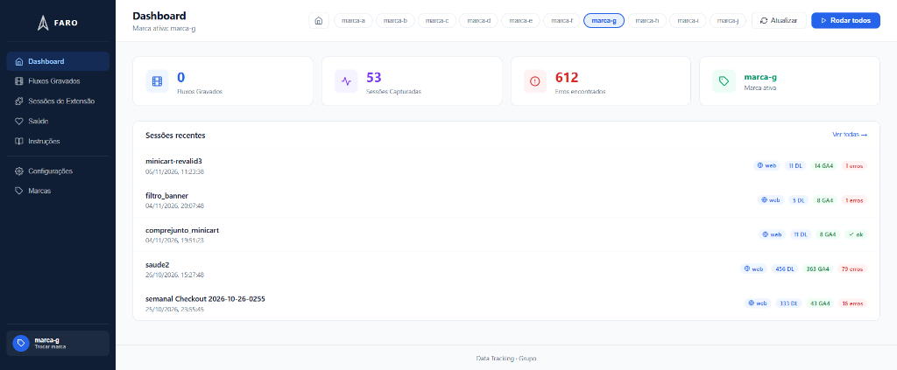
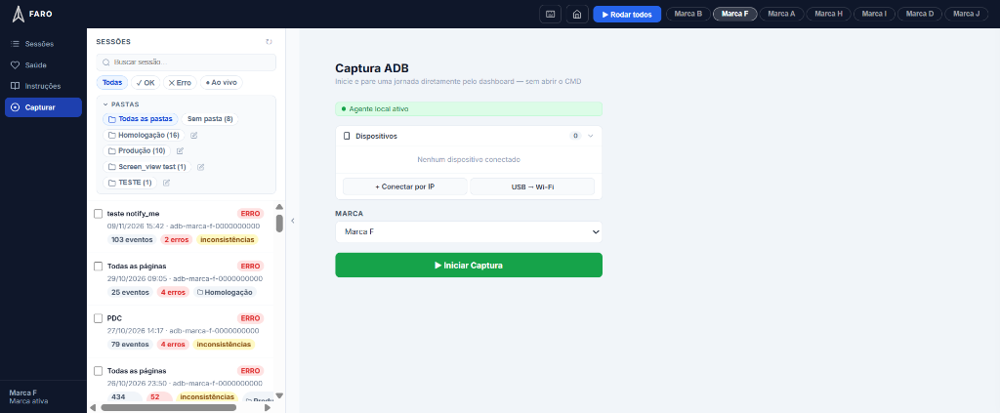
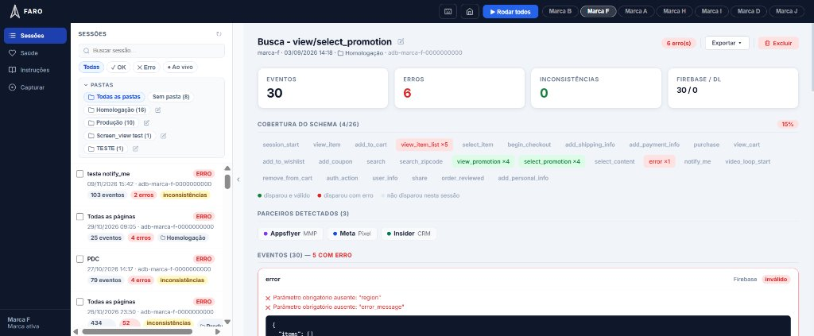
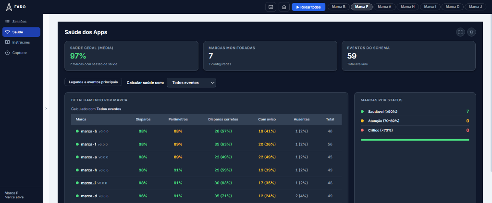

<!-- ====== HERO ====== -->
<div align="center">
  <h1>FARO</h1>
  <h3>Server-Side Data Quality &amp; Tracking Validation Framework</h3>
  <p><i>Auditoria em tempo real de eventos Web (dataLayer / GA4) e Mobile (Firebase / ADB) orientada a Schema Enforcement.</i></p>

  <p>
    
    
    
    
    
    
    
    
    
    
  </p>
</div>

<br>

<!-- ====== STACK CARD ====== -->
<div align="center" style="background-color:#0d1117; padding:20px; border-radius:12px; border:1px solid rgba(255,255,255,0.1);">
  <h3>Stack &amp; Arquitetura do Projeto</h3>
  <p align="center">
    
    
    
    
    
    
    
    
  </p>
</div>

<br>

> [!NOTE]
> **Nota de Confidencialidade:** Este repositório apresenta a arquitetura, o código-fonte sanitizado e a documentação técnica de um framework corporativo de Data Quality. Dados sensíveis, regras de negócio proprietárias e credenciais foram omitidos em conformidade com NDAs. Todas as capturas de tela foram anonimizadas (`marca-a` a `marca-j`, identificadores e URLs genéricos).

---

## Visão Executiva

### O Desafio
Em ecossistemas de e-commerce multi-marca (Web e Mobile), garantir a integridade e a conformidade dos eventos analíticos é crítico. Falhas na coleta (`dataLayer` ou SDKs Mobile) geram inconsistências que comprometem a confiabilidade do Data Warehouse (BigQuery/GCP) e das atribuições de mídia. Auditorias manuais são reativas, lentas e difíceis de escalar entre múltiplas frentes.

### A Solução
O **Faro** atua como um gateway de qualidade de dados orientado a **Shift-Left Testing**, identificando anomalias de estrutura, tipagem e obrigatoriedade de parâmetros (**Schema Enforcement**) no momento em que os eventos são disparados nas aplicações clientes — cobrindo **Web** e **Android** sob uma mesma plataforma.

### Arquitetura e Aceleração com IA
O desenvolvimento do projeto combinou engenharia tradicional com fluxos de **AI-Assisted Engineering**:

- **Backend e Pipeline de Captura:** Refatoração de fluxos assíncronos em Node.js, lógica de interceptação no navegador e integração ADB ↔ Servidor acelerados com **Claude Code**.
- **Interface e Visualização de Dados:** Dashboard em React + Vite estruturado com engenharia de prompt avançada para geração de componentes limpos e responsivos.
- **Automação de Auditoria:** Geração assistida de mapeamentos de eventos, normalizadores de payload e suítes de testes de validação.

---

## Visão Geral das Plataformas

O Faro cobre duas plataformas com pipelines distintos que convergem para um modelo único de sessão e validação:

| Dimensão | Faro Web | Faro App (Android) |
|---|---|---|
| **Fonte de captura** | `dataLayer` + hits GA4 + pixels de parceiros | Eventos Firebase / GA4 via `logcat` |
| **Mecanismo** | Extensão Chrome (Manifest V3) | Agente local Node.js + ponte ADB |
| **Especificação** | `schema.json` | `mobile/coverage-schema.json` |
| **Interface** | `/` (React + Vite) | `/mobile` |

---

## 1. Ponto de Entrada

Ao acessar a aplicação, o usuário seleciona a plataforma de validação (**Web** ou **App**). Ambas compartilham o mesmo servidor, armazenamento de sessões e motor de saúde, mas operam com telas e fluxos dedicados.

<p align="center">
  
</p>

Após a seleção da plataforma, escolhe-se a marca ativa. Toda a navegação subsequente ocorre dentro desse contexto.

---

## 2. Modelo Central: A Sessão

Toda a operação do Faro gira em torno da **sessão** — o registro completo de uma navegação real, do início ao fim, com todos os eventos disparados no percurso.

Cada sessão armazena:

- **Eventos de origem:** `dataLayer` (Web) ou Firebase (App), em ordem cronológica;
- **Hits de saída:** requisições GA4 efetivamente enviadas pelo navegador/app;
- **Parceiros detectados:** pixels e SDKs de terceiros (Meta, AppsFlyer, Insider, etc.);
- **Resultado da validação:** conformidade de cada evento e parâmetro frente ao schema;
- **Metadados:** marca, responsável, data, pasta de organização e ambiente.

As sessões são persistidas de forma versionada via API do GitHub, dispensando banco de dados dedicado e permitindo consulta histórica centralizada.

---

## 3. Faro Web

### 3.1 Mecanismo de Captura

A extensão Chrome (Manifest V3, em `extensao-v2/`) injeta dois scripts em toda página:

- **`injector.js`:** executa no *main world* em `document_start`, antes dos scripts da aplicação. Sobrescreve `dataLayer.push` para registrar entradas, intercepta hits de saída do GA4 e escuta o *message bus* do container do GTM — distinguindo o que foi empurrado para o `dataLayer` do que a tag efetivamente transmitiu.
- **`content.js`:** executa em contexto isolado como ponte entre a página e o service worker (`background.js`), que acumula a sessão.

Ao encerrar a gravação, a extensão envia a sessão para `POST /api/save-session`.

### 3.2 Dashboard Web

<p align="center">
  
</p>

A navegação lateral organiza os módulos da plataforma:

- **Dashboard:** indicadores consolidados e sessões recentes da marca ativa;
- **Fluxos Gravados:** jornadas reutilizáveis para reprodução automatizada;
- **Sessões de Extensão:** histórico completo com organização por pastas;
- **Saúde:** painel executivo de cobertura (Seção 5);
- **Instruções:** guia de instalação e uso da extensão;
- **Configurações / Marcas:** cadastro de marcas e domínios sGTM.

### 3.3 Inspeção de Sessão

Cada sessão é exibida em três visões complementares:

- **Resumo:** veredito geral, contagem de erros de schema, inconsistências e eventos sem hit correspondente no GA4;
- **Detalhamento:** auditoria evento a evento;
- **Parceiros:** pixels de terceiros detectados durante a navegação.

<p align="center">
  
</p>

O Detalhamento apresenta a validação parâmetro a parâmetro e o payload integral de cada evento capturado, aplicando regras condicionais específicas por plataforma.

---

## 4. Faro App

### 4.1 Mecanismo de Captura

No ambiente Mobile, a captura é composta por três camadas:

1. **Dispositivo Android:** conectado via USB ou Wi-Fi, com o modo debug do Firebase habilitado.
2. **Agente Local (`mobile/faro-agente.js`):** serviço executado na máquina do analista em `localhost:3001`, responsável por receber comandos da interface web.
3. **Captura ADB (`mobile/adb-capture.js`):** processo disparado pelo agente que lê o `logcat` do aparelho, extrai eventos Firebase (`FA: Logging event (FE): …` e `FA-SVC … name=…,params=Bundle[{…}]`), realiza o *parse* do `Bundle` e envia cada evento para `POST /api/mobile/ingest/:sessionId`.

Essa arquitetura desacopla o servidor em Cloud Run da conexão física USB do analista, permitindo iniciar e encerrar capturas diretamente pelo navegador.

<p align="center">
  
</p>

O painel exibe o status do agente local, lista dispositivos conectados e oferece conexão por IP ou conversão de USB para Wi-Fi.

### 4.2 Dashboard do App

<p align="center">
  
</p>

As sessões ficam listadas à esquerda, organizadas por ambiente/pasta (Homologação, Produção, etc.) com filtros por status. Capturas em andamento exibem o estado **Ao vivo**, recebendo eventos em tempo real via **Server-Sent Events (SSE)**.

<p align="center">
  
</p>

A visão detalhada da sessão apresenta:

- Contadores de eventos, erros, inconsistências e distribuição **Firebase / DL**;
- **Cobertura do schema:** matriz completa de eventos esperados para a marca, diferenciando eventos válidos, com erro ou ausentes;
- **Parceiros detectados**;
- Lista de eventos com destaque para divergências.

### 4.3 Validação de Payloads Mobile

<p align="center">
  
</p>

Cada ocorrência inválida exibe a regra violada em linguagem objetiva — como ausência de `items` em `view_item_list` ou falta de parâmetros obrigatórios (`region`, `error_message`) em `error` — acompanhada do payload bruto emitido pelo dispositivo.

---

## 5. Área de Saúde

Enquanto a sessão responde *"o que falhou nesta navegação?"*, a área de **Saúde** responde *"qual é o percentual de conformidade desta marca hoje?"*.

### Cálculo do Indicador

Cada par **evento × região** previsto no schema para uma marca representa um ponto de checagem. O score reflete a proporção de pontos válidos na **sessão de referência** da marca, desconsiderando eventos não aplicáveis àquela loja ou região.

Critério de seleção da sessão de referência:

- **Web:** sessão marcada como referência, registrada em `config/health-<marca>.json`;
- **App:** sessão mais recente da pasta `Produção`.

<p align="center">
  
</p>

<p align="center">
  
</p>

Os painéis consolidam a média geral, o total de marcas monitoradas, o volume de eventos avaliados e o detalhamento por marca — separando **disparos corretos**, **com aviso** (disparou com falha de parâmetro) e **ausentes**. A distinção entre as colunas *Disparos* e *Parâmetros* evidencia casos em que o evento foi emitido, mas com payload incompleto.

---

## 6. Especificação (Schemas e Exceções)

A validação de sessões e o cálculo de saúde compartilham a mesma fonte de verdade:

- `schema.json` — especificação Web
- `mobile/coverage-schema.json` — especificação App

Cada entrada define o evento, a região, os parâmetros obrigatórios e as marcas aplicáveis (`marcas_site` / `marcas_app`). Exceções específicas por marca e região são declaradas em `eventos-opcionais.js`, evitando falsos negativos na cobertura.

> [!IMPORTANT]
> Alterações nos schemas impactam simultaneamente a validação de sessões (incluindo histórico) e os indicadores da área de Saúde.

---

## 7. Estrutura do Repositório

```text
server.js                  API, motor de validação e regras de saúde (Web e App)
validator.js               Validador de sessões Web contra o schema
schema.json                Especificação de referência — Web
eventos-opcionais.js       Isenções por marca e região

extensao-v2/               Extensão Chrome (Manifest V3)
  src/injector.js            Interceptação de dataLayer e hits GA4 (main world)
  src/content.js             Ponte página ↔ extensão
  src/background.js          Acúmulo de sessão e envio ao servidor

mobile/                    Faro App (Android)
  faro-agente.js             Agente local (localhost:3001)
  adb-capture.js             Leitura de logcat e parse de eventos Firebase
  payload-mapper.js          Normalização e validação de payloads mobile
  session-manager.js         Ciclo de vida das sessões
  coverage-schema.json       Especificação de referência — App
  dashboard.html             Interface do Faro App

dashboard/                 Interface do Faro Web (React + Vite)
  src/health/                Componentes da área de Saúde
```

---

## 8. Operação

O servidor do Faro é implantado no **Google Cloud Run** (build da imagem a partir da raiz, publicação no Artifact Registry e deploy contínuo). Os componentes locais do analista (`mobile/faro-agente.js` e `mobile/adb-capture.js`) operam diretamente na estação de trabalho para acesso ao ADB.

---

## Autor

<p align="center">
  <a href="mailto:wendelrfm@gmail.com"></a>
  <a href="https://www.linkedin.com/in/wendel-mata-b31633206/"></a>
  <a href="https://github.com/WendelMata"></a>
</p>
