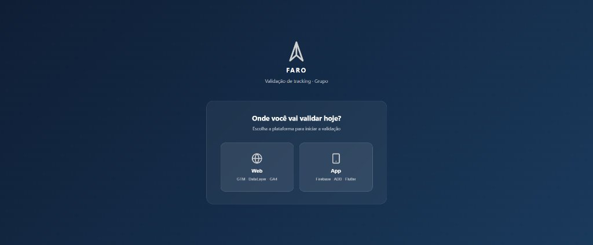
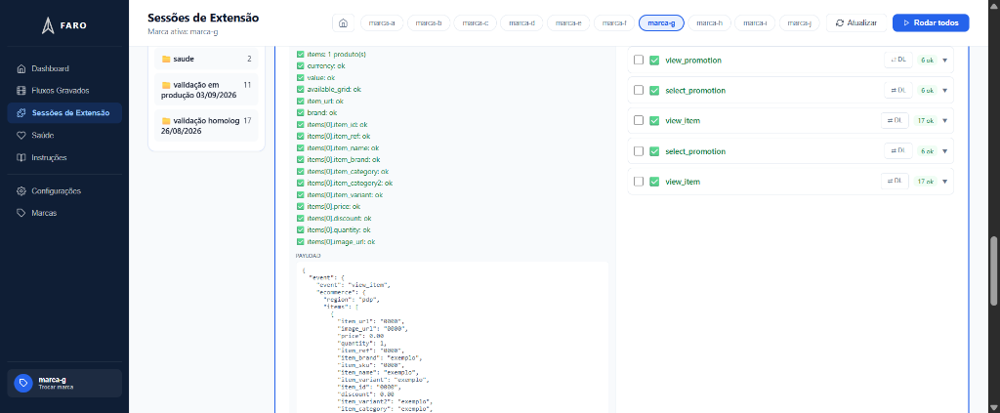
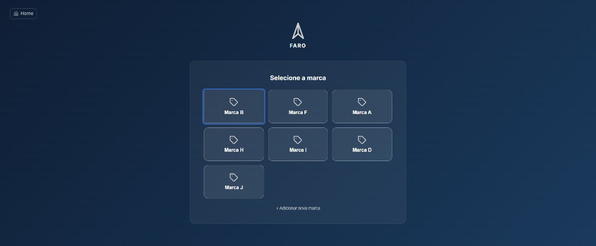
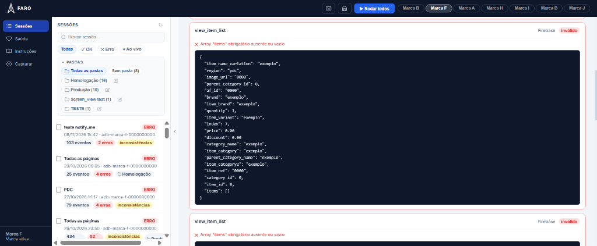
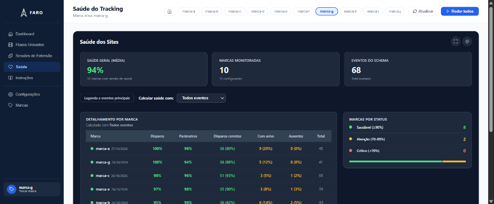

# Faro — Documentação

Faro é uma ferramenta interna de validação de tracking multi-marca. Ele captura os
eventos de analytics que realmente dispararam numa navegação real, compara com a
especificação de referência e mostra onde a implementação diverge.

Cobre duas plataformas, com o mesmo conceito e pipelines diferentes:

| | **Faro Web** | **Faro App** |
|---|---|---|
| O que captura | `dataLayer` + hits de GA4 + pixels de parceiro | eventos Firebase/GA4 do app Android |
| Como captura | extensão Chrome | agente local lendo o `logcat` via ADB |
| Especificação | `schema.json` | `mobile/coverage-schema.json` |
| Tela | `/` | `/mobile` |

> **Sobre os prints deste documento:** todos foram tirados do ambiente real e depois
> anonimizados — nomes de marca viraram `marca-a … marca-j`, e nomes de produto, preços,
> URLs e identificadores foram substituídos por valores genéricos. O que você vê é a
> interface de verdade; os dados não são.

---

## 1. Ponto de entrada

Ao abrir o Faro, a primeira escolha é a plataforma. As duas metades compartilham servidor,
armazenamento e conceito de sessão, mas têm telas próprias.



Depois da plataforma, escolhe-se a marca. Toda a navegação seguinte é no contexto dela.

---

## 2. Conceito central: a sessão

Tudo no Faro gira em torno da **sessão** — o registro de uma navegação real, do início ao fim,
com todos os eventos que dispararam no caminho.

Uma sessão guarda:

- **eventos de `dataLayer`** (Web) ou **eventos Firebase** (App), na ordem em que ocorreram;
- **os hits de GA4** que efetivamente saíram do navegador/app;
- **hits de parceiros** detectados (Meta, AppsFlyer, Insider, etc.);
- **o resultado da validação** contra o schema;
- metadados: marca, testador, data, pasta, ambiente.

Sessões ficam gravadas no repositório (via API do GitHub), não num banco. Isso é o que
permite que o histórico seja versionado e que o dashboard leia de qualquer lugar.

---

## 3. Faro Web

### 3.1 Como a captura acontece

A extensão Chrome (MV3, em `extensao-v2/`) injeta dois scripts em toda página:

- **`injector.js`** roda no *mundo principal* da página, em `document_start` — antes de
  qualquer script do site. Ele substitui `dataLayer.push` por uma versão que registra o
  que passou, intercepta os hits de GA4 na saída e também escuta o *message bus* do
  container do GTM. É por isso que o Faro sabe não só o que foi empurrado para o
  `dataLayer`, mas o que a tag realmente enviou.
- **`content.js`** roda isolado e serve de ponte: repassa o que o injector capturou para o
  service worker da extensão (`background.js`), que acumula a sessão.

Ao parar a captura, a extensão envia a sessão para `POST /api/save-session`.

A distinção entre "foi empurrado" e "realmente chegou" é o ponto mais importante do Faro Web:
um evento pode estar no `dataLayer` e nunca virar hit de GA4 — e o contrário também acontece.

### 3.2 O dashboard


A navegação lateral tem:

- **Dashboard** — contadores e sessões recentes da marca ativa;
- **Fluxos Gravados** — jornadas gravadas que podem ser reproduzidas automaticamente;
- **Sessões de Extensão** — todas as sessões capturadas, organizáveis em pastas;
- **Saúde** — o painel de cobertura (seção 5);
- **Instruções** — o passo a passo de instalação da extensão;
- **Configurações / Marcas** — cadastro de marcas e domínio sGTM de cada uma.

### 3.3 Lendo uma sessão

Cada sessão abre em três abas:

- **Resumo** — veredito geral, contagem de erros de schema, inconsistências e eventos que
  não chegaram ao GA4;
- **Detalhamento** — a comparação evento a evento;
- **Parceiros** — os pixels de terceiros detectados.



O Detalhamento mostra a validação parâmetro a parâmetro e o payload completo de cada evento
capturado (comparando `dataLayer` e `GA4` capturado), aplicando regras específicas por plataforma.

---

## 4. Faro App

### 4.1 Como a captura acontece

No App não existe extensão. A captura depende de três peças:

1. **O aparelho Android**, conectado por USB ou Wi-Fi, com o modo debug do Firebase ativo.
2. **O agente local** (`mobile/faro-agente.js`), que roda na máquina do analista — sobe um
   pequeno servidor em `localhost:3001` e fica esperando comandos.
3. **O `adb-capture.js`**, que o agente dispara. Ele lê o `logcat` do aparelho e extrai os
   eventos do Firebase das linhas de log (`FA: Logging event (FE): …` e
   `FA-SVC … name=…,params=Bundle[{…}]`), faz o *parse* do Bundle e envia cada evento para
   `POST /api/mobile/ingest/:sessionId`.

O agente existe por um motivo específico: o servidor do Faro roda no Cloud Run e não tem
acesso ao USB do analista. Com o agente no meio, o botão de iniciar/parar funciona pelo
dashboard, sem ninguém precisar abrir o CMD.


O painel mostra se o agente local está ativo, quais aparelhos estão conectados, e permite
conectar por IP ou converter uma conexão USB em Wi-Fi.

### 4.2 O dashboard do App



As sessões ficam à esquerda, organizadas por pasta (Homologação, Produção, etc.) e
filtráveis por status. Sessões em andamento aparecem como **Ao vivo** — o servidor
transmite os eventos em tempo real por SSE enquanto a captura acontece.


O detalhe de uma sessão traz:

- os contadores de eventos, erros e inconsistências, e a divisão **Firebase / DL**;
- a **cobertura do schema** — todos os eventos esperados para a marca, com cor indicando
  se dispararam e passaram, dispararam com erro, ou não dispararam nesta sessão;
- os **parceiros detectados**;
- a lista de eventos, com os problemas destacados.

### 4.3 Validação no App



Cada evento inválido mostra o motivo em linguagem direta — no print, `view_item_list`
disparou com o array `items` vazio, e `error` chegou sem `region` e sem `error_message` —
seguido do payload que o aparelho realmente emitiu.

---

## 5. Área de Saúde

A Saúde responde a uma pergunta diferente da sessão. A sessão pergunta *"o que deu errado
nesta navegação?"*; a Saúde pergunta *"quanto da especificação esta marca cumpre hoje?"*.

### 5.1 Como o número sai

Cada par **evento × região** previsto no schema para aquela marca é um ponto de checagem.
O score é a proporção de pontos de checagem que dispararam corretamente na **sessão de
referência** da marca. Eventos que não se aplicam àquela marca ou região são removidos da
conta, em vez de contarem como falha.

A sessão de referência é escolhida assim:

- **Web** — a sessão marcada com o coração (`❤️`), gravada em `config/health-<marca>.json`;
- **App** — a sessão mais recente na pasta `Produção`.




As duas telas trazem a média geral, a quantidade de marcas monitoradas, o total de eventos
avaliados do schema e o detalhamento por marca, separando **disparos corretos**,
**com aviso** (disparou, mas algum parâmetro tem problema) e **ausentes** (não apareceu na
sessão).

A diferença entre a coluna *Disparos* e a coluna *Parâmetros* é proposital: uma marca pode
disparar todos os eventos esperados e ainda assim ter parâmetros faltando.

---

## 6. O schema

O schema é a especificação de referência — o que *deveria* acontecer. É contra ele que toda
validação roda.

- `schema.json` — Web
- `mobile/coverage-schema.json` — App

Cada entrada descreve um evento numa região, quais parâmetros são obrigatórios, e em quais
marcas ele se aplica (`marcas_site` / `marcas_app`). Um evento previsto para oito marcas e
ausente numa nona simplesmente não é cobrado dela.

Também existe `eventos-opcionais.js`, que marca combinações de evento/região que não se
aplicam a uma marca específica — a diferença importa: o schema gera lacuna, o arquivo de
opcionais isenta.

> **Atenção ao alterar o schema:** ele alimenta ao mesmo tempo a validação de sessão e o
> cálculo de saúde. Mudar um `required` para resolver um número da Saúde muda o veredito de
> todas as sessões, inclusive as antigas.

---

## 7. Estrutura do repositório

```
server.js                  API e regras de validação/saúde das duas plataformas
validator.js               validação de sessão Web contra o schema
schema.json                especificação de referência — Web
eventos-opcionais.js       isenções por marca/região

extensao-v2/               extensão Chrome (captura Web)
  src/injector.js            patch do dataLayer + captura de GA4 (mundo principal)
  src/content.js             ponte página ↔ extensão
  src/background.js          acumula a sessão e envia ao servidor

mobile/                    Faro App
  faro-agente.js             agente local (localhost:3001)
  adb-capture.js             leitura do logcat e parse dos eventos Firebase
  payload-mapper.js          normalização e validação dos eventos do app
  session-manager.js         ciclo de vida da sessão
  coverage-schema.json       especificação de referência — App
  dashboard.html             interface do Faro App

dashboard/                 interface do Faro Web (React + Vite)
  src/health/                telas da área de Saúde
```

---

## 8. Operação

O Faro roda no **Cloud Run**. O deploy é feito pelo Cloud Shell: build da imagem a partir da
raiz do repositório, push para o Artifact Registry e `gcloud run deploy`. O tráfego já
acompanha a revisão mais nova automaticamente.

Duas coisas **não** chegam por deploy, porque rodam na máquina do analista:
`mobile/faro-agente.js` e `mobile/adb-capture.js`.
